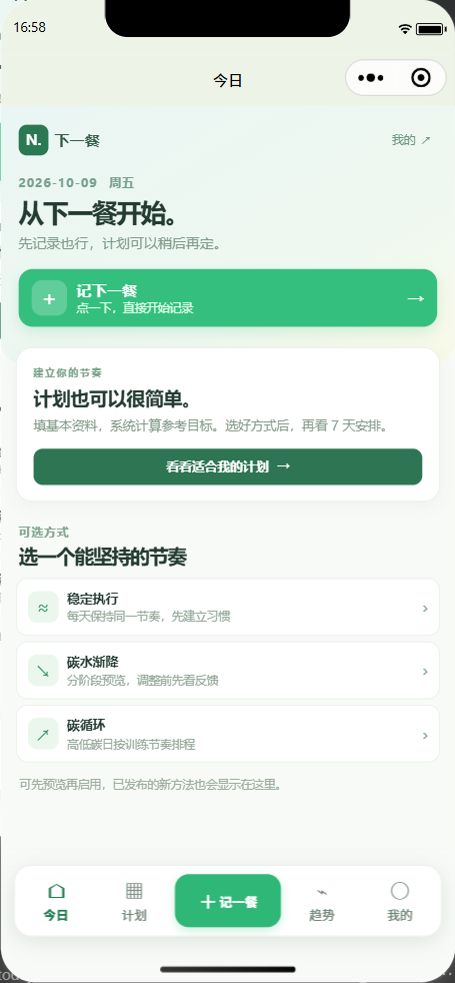
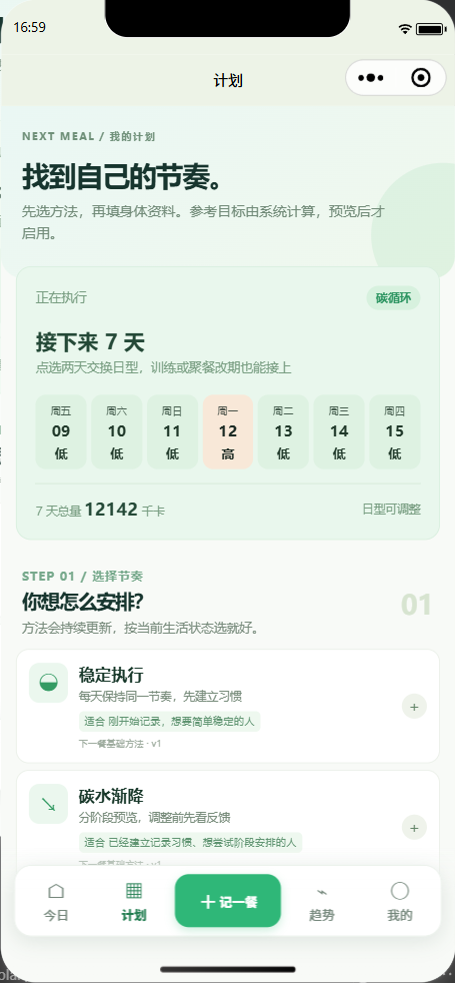
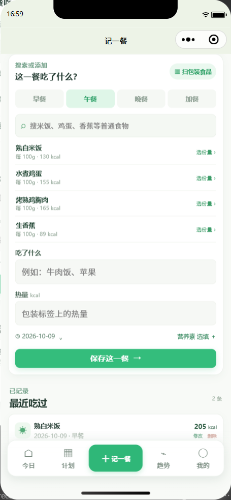
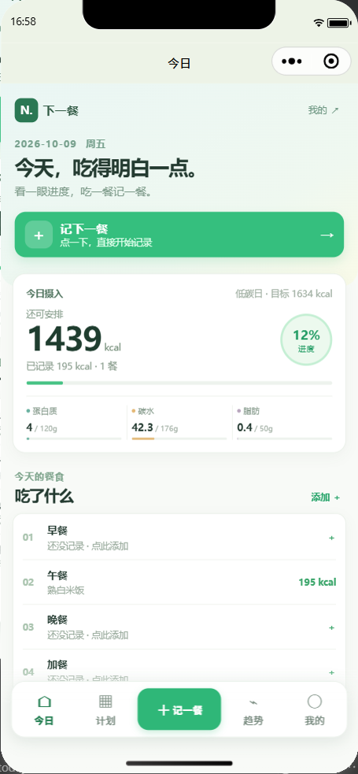
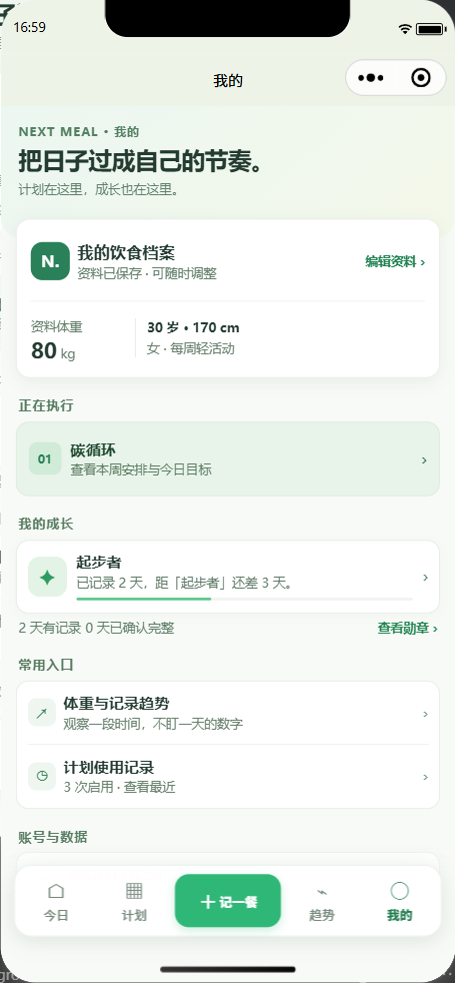
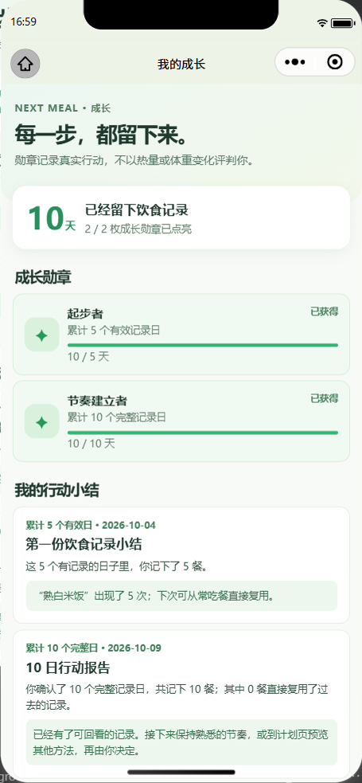

# 下一餐｜减脂计划微信小程序（源码公开版）

一款围绕「先把下一餐记下来」制作的原生微信小程序。本仓库包含小程序、本地方法管理后台、自动化测试和演示截图。**当前是本地可运行的开发预览版，尚未发布成可供大众直接使用的微信小程序。**

> 给同样没有开发经验、但想把一个想法做出来的人：这份源码记录了我如何借助 AI，把需求、页面、计算、后台和测试一步步落地。它不是“点一下就生成成品”，更不是已经经过专业审阅的减脂方案。

## 为什么公开源码

我最初只是想做一个自己愿意每天打开的饮食计划工具：不必手填每天的热量和三大营养素，记一餐不必在页面里反复翻找，也希望连续记录能得到看得见的反馈。做的过程中，我发现真正困难的不是画几个页面，而是把计划、记录、成长和数据管理连起来，再认真测试每条操作路径。

现在把这一版源码和真实界面截图放出来，有三个目的：

1. 留下一份从想法到可运行原型的过程，供同样从零开始的人阅读。
2. 让功能、公式假设和未完成的部分都透明，欢迎通过 Issue 指出问题。
3. 继续听真实使用者的反馈，优先改进“愿不愿意坚持记录”这件事。

**协议说明：**目前仅公开源码，暂未附加开源许可证。公开仓库不等于授予复制、修改或再发布权利；后续确定协议时会在仓库中明确更新。关于这一点可参阅 [GitHub 的仓库许可说明](https://docs.github.com/en/repositories/managing-your-repositorys-settings-and-features/customizing-your-repository/licensing-a-repository)。

## 现在能做什么

| 模块 | 当前能力 |
|---|---|
| 今日 | 首屏直接“记下一餐”；展示当日摄入、参考目标、三大营养素、餐别、常吃餐和明日安排 |
| 计划 | 填年龄、身高、体重、计算用性别与活动量后，自动生成参考热量与三大营养素；可预览并启用稳定执行、碳水渐降、碳循环三种节奏 |
| 记餐 | 普通食物搜索、克数换算、手动添加、餐别选择、最近餐食复用、修改与撤销；包装食品可按条码查询候选并由用户核对 |
| 成长 | 5 个有效记录日、10 个完整记录日的勋章，以及根据真实记录生成的阶段小结 |
| 趋势 | 晨重、近 7 天记录复盘与记录明细；数据不足时给出原因 |
| 本地后台 | 管理员登录，减脂方法草稿、发布、下架，以及本地测试账号配对、SQLite 存储与离线后同步 |

方法后台**只组合目前已有的三类计算规则**，不是输入任意新公式就能自动执行。增肌计划、正式微信身份、远程服务和完整中文食物库仍未完成。

## 界面预览

以下均为隔离测试数据和微信开发者工具模拟器截图，不包含真实用户资料。

**打开后先看到记餐入口**



**计划页查看接下来的日型与方法**



**查食物、记餐，也能复用吃过的餐食**



**记完一餐，今日进度立即更新**



**个人档案与成长进度**



**5 天与 10 天行动勋章**



## 本地运行

环境：微信开发者工具、Node.js 24 或更新版本。这里只说明本机试运行，**不是线上部署步骤**。

1. 克隆本仓库，将 `next-meal-miniapp` 导入微信开发者工具。`project.config.json` 中的 `touristappid` 是公开仓库占位值；用自己的测试 AppID 时，请先核对归属。
2. 在终端启动本地后台：

   ```bash
   cd next-meal-platform
   npm start
   ```

3. 后台仅监听本机 `127.0.0.1:8787`。首次运行终端会显示一次性管理员初始化码，在 `http://127.0.0.1:8787/admin` 设置自己的管理员账号和密码。**不要把初始化码、密码、数据库文件提交到仓库。**
4. 小程序 `config/runtime.js` 默认指向 `http://127.0.0.1:8787`，用于开发者工具模拟器联调；手机里的 `127.0.0.1` 指手机本身，因此这不是可直接真机使用的后台地址。
5. 在“计划”填写基础资料并确认适用情况，生成参考目标、预览 7 天后再启用。之后可在“记一餐”记录饮食，在“我的”查看成长。

本地代码测试：

```bash
cd next-meal-miniapp
npm install
npm test

cd ../next-meal-platform
npm test
```

隔离模拟器的端到端测试见 [`next-meal-miniapp/tests/README-local-e2e.md`](next-meal-miniapp/tests/README-local-e2e.md)。它需要本机微信开发者工具的服务端口，默认测试服务使用 `8788`，不会写入运行中的 `8787` 数据库。

## 目录

```text
next-meal-miniapp/   微信小程序页面、计算与本机存储
next-meal-platform/  本地 Node.js + SQLite 方法后台
docs/images/         隔离测试界面截图
```

仓库特意不包含竞品参考源码、本机 SQLite 数据库、真实管理员凭据、`node_modules` 和临时测试产物。

## 数值与数据边界

- 起始目标采用 Mifflin–St Jeor 静息消耗估算，并结合活动量生成参考起点；当前约 15% 的差额、宏量分配和渐降/碳循环默认参数都是**待专业审阅的原型规则**。这些数字不能预测减脂效果，也不构成个体化营养或医疗方案。
- 内置普通食物目前只有 10 条示例，来源为 [USDA FoodData Central](https://fdc.nal.usda.gov/) 的 SR Legacy 2018 数据；USDA 将 FoodData Central 数据列为 CC0/公共领域，仍请保留来源说明。
- 包装食品条码候选通过 [Open Food Facts API](https://openfoodfacts.github.io/documentation/docs/Product-Opener/api/) 获取。其资料由社区贡献，可能不完整或不准确；数据库使用 ODbL 等条款，实际使用前应阅读来源要求。应用要求用户核对包装标签和真实份量，不凭空生成营养数值。
- 当前本地配对和 SQLite 只用于开发验证；正式身份、隐私告知、数据保护、专业审阅、真机适配和发布检查尚未完成。

## 交流

欢迎在 [Issues](https://github.com/dumbneuron/next-meal-miniapp/issues) 留下实际使用障碍、界面意见或可核对的数据来源。请勿在公开 Issue 中上传个人体重、饮食记录、账号密码或配对码。

制作记录：**带薪摸鱼研究所** · 2026 年 10 月
